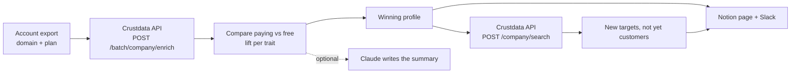

# ICP Rewriter (Open Source, Rebuild Your ICP From Paying Accounts)

**An open-source Python tool that rebuilds your ideal customer profile from the accounts that actually pay, then finds new companies that match it.**

Most ICP slides are a guess someone made on day one. Your product database already knows better: it holds every paying and free account with its domain. This tool enriches each domain with company size, funding stage, industry and country, compares who pays with who does not, writes the winning profile, and pulls a fresh target list. [Crustdata](https://crustdata.com) is the company data layer ([API docs](https://docs.crustdata.com)).


## How it works



1. **Export.** A CSV with `domain` and `plan` from your database (a Supabase query is below). Any plan other than `free`, `trial`, `false`, `0` or empty counts as paying.
2. **Enrich.** One async `POST /batch/company/enrich` job for the whole list (up to 10,000 domains), polled with `GET /batch/{id}`. It asks for headcount, last funding round, industry and country. Domains that cannot be resolved are dropped, never guessed.
3. **Compare.** For every value of every trait (size band, funding stage, industry, country) the tool computes the conversion rate and its lift over your overall rate.
4. **Write the ICP.** A value joins the profile only if it has at least `MIN_SUPPORT` accounts (default 3) and a lift of at least `MIN_LIFT` (default 1.25). Unknown values never qualify. All of this is plain code with unit tests, not a prompt.
5. **Find lookalikes.** The profile becomes a `POST /company/search` filter (`headcount.total`, `funding.last_round_type`, `taxonomy.professional_network_industry`, `locations.country`). Domains already in your export are removed from the results.
6. **Publish.** `out/icp.md`, `out/targets.csv`, an optional Notion page and an optional Slack message.

## Quickstart

Requires Python 3.9+. No dependencies for the core tool.

```bash
git clone https://github.com/mhimed-crustdata/icp-rewriter
cd icp-rewriter
make setup        # creates .env, then add your CRUSTDATA_API_KEY
# export your accounts to accounts.csv (columns: domain, plan)
make demo         # never posts to Slack or Notion
make run          # also creates the Notion page when configured
make test         # unit tests, no network
```

Export from Supabase (SQL editor, then download as CSV):

```sql
select split_part(email, '@', 2) as domain, plan
from accounts;   -- or select domain, plan from your workspaces table
```

Run it every quarter with cron (`0 8 1 */3 * cd /path/to/repo && make run`) or a scheduled CI job with your keys stored as secrets.

## Configuration

| Variable | Default | What it does |
|---|---|---|
| `CRUSTDATA_API_KEY` | required | Your Crustdata API key. Read from the environment only |
| `ACCOUNTS_CSV` | `accounts.csv` | The export. Flags `--domain-col` and `--plan-col` rename the columns |
| `MIN_SUPPORT` | `3` | Fewest accounts a value needs before it can join the ICP |
| `MIN_LIFT` | `1.25` | How much better than average a value must convert |
| `SLACK_WEBHOOK_URL` | empty | Slack incoming webhook. Empty means no Slack post |
| `NOTION_TOKEN` | empty | Notion internal integration token (with `--notion`) |
| `NOTION_PARENT_PAGE_ID` | empty | Page the ICP page is created under |
| `ANTHROPIC_API_KEY` | empty | Optional Claude step (`--claude`) |
| `ANTHROPIC_MODEL` | `claude-opus-5-5` | Model for the optional Claude step |

Output files in `out/` describe your customers and are git-ignored.

## Example output

A real run on 2026-11-05 against the live API. Your paying and free labels are private, so this run uses a sample of 10 public software companies (no plan labels) to check the enrichment, then an example profile to check the lookalike search. Aggregated:

```json
{
  "enrich": {
    "submitted": 10,
    "resolved": 10,
    "size_band": {"11-50": 2, "51-200": 5, "201-500": 3},
    "last_round": {"series_b": 6, "seed_or_series_a": 4},
    "industry_filled": 10,
    "country_filled": 10
  },
  "lookalike_search": {
    "example_icp": "11-200 people, seed or series A, software development, USA",
    "matches_in_index": 3658,
    "first_100_by_size": {"11-50": 60, "51-200": 40},
    "first_100_by_stage": {"series_a": 60, "seed": 40}
  }
}
```

What the Slack message looks like:

```text
:dart: ICP refreshed from 212 paying and 1,480 free accounts
• Winning profile: size: 11-50, 51-200; stage: seed, series_a; industry: Software Development
• 100 new target companies (3658 match in total)
```

## How to build an ICP refresh agent

1. **Start from payment, not from opinion.** The label is your own billing data: who converted from free to paid.
2. **Enrich with firmographics.** One batch call returns size, funding, industry and country for the whole list. See the [company enrichment docs](https://docs.crustdata.com).
3. **Measure lift, with a floor on sample size.** A value with two accounts and a 100% conversion rate is noise. `MIN_SUPPORT` keeps it out.
4. **Turn the profile into a search.** The same traits you measured become the filter on `POST /company/search`, so the target list and the ICP can never drift apart.
5. **Use the model for the words, not the numbers.** Claude can write the one-paragraph ICP from the stats table, but the winners are picked by code.
6. **Put it where the team works.** A Notion page for the ICP and target list, a Slack message for the headline.

## FAQ

**How to refine ICP from customer data?**
Export your paying and free accounts with their domains, enrich them with company size, funding, industry and country, and compare conversion rates per trait. The traits that convert clearly better than your average, with enough accounts behind them, are your new ICP. This tool does that in one command.

**How does it avoid a noisy ICP?**
A value needs `MIN_SUPPORT` accounts and a `MIN_LIFT` conversion advantage. Unresolved domains are dropped rather than guessed, and "unknown" is never a winning value.

**What if I have very few paying accounts?**
The tool still runs, but with fewer than about 30 paying accounts treat the output as a hint. Lower `MIN_SUPPORT` only if you accept that.

**Does it contact anyone?**
No. It only posts to your own Slack webhook and Notion page when they are configured and `--dry-run` is off.

**Is Claude required?**
No. It is optional and off unless `ANTHROPIC_API_KEY` is set and you pass `--claude`.

**Which Crustdata endpoints does it use?**
`POST /batch/company/enrich` (plus `GET /batch/{id}` to poll it) and `POST /company/search`, on API version `2025-11-01`. See the [Crustdata API docs](https://docs.crustdata.com).

## Project layout

```text
icp.py              # the workflow: compare, build the ICP, find lookalikes
crustdata_api.py    # tiny Crustdata client with batch polling (stdlib only)
notify.py           # optional Slack, Notion and Claude
examples/           # the CSV format
tests/              # unit tests, no network
```

## License

MIT. See [LICENSE](LICENSE). Data layer: [Crustdata](https://crustdata.com) ([docs](https://docs.crustdata.com)).
